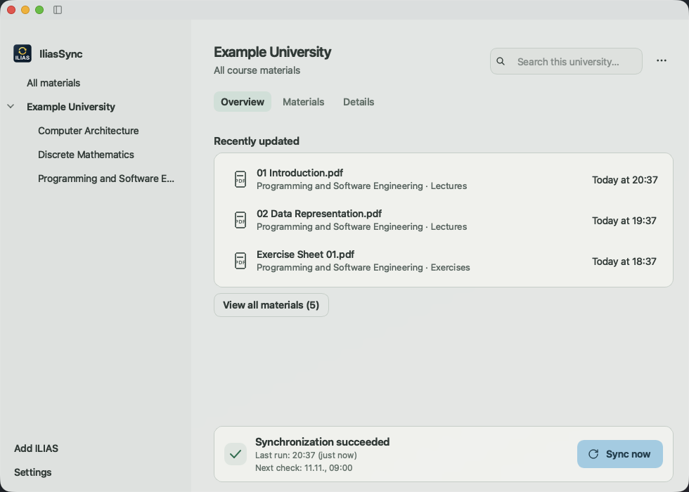

  
  <h1>IliasSync</h1>
  
<strong>Dein Studium. Deine Dateien. Automatisch auf deinem Computer.</strong>

  
Eine ruhige Desktop-App für ILIAS-Materialien – auf macOS, Windows und Linux.

  

    <a href="https://github.com/schroedernils/ilias-sync/releases/latest">Herunterladen</a> ·
    <a href="#schnellstart">Schnellstart</a> ·
    <a href="docs/INSTALLATION.md">Installation</a> ·
    <a href="https://github.com/schroedernils/ilias-sync/issues/new/choose">Hilfe & Feedback</a>
  

  

    
    
    
  

<picture>
  <source media="(prefers-color-scheme: dark)" srcset="docs/images/app-dark.png">
  
</picture>

Aktuelle Produktoberfläche mit synthetischen Beispieldaten. Keine privaten Konten oder Kursunterlagen.

IliasSync hält die Materialien deiner ausgewählten ILIAS-Kurse in deinen eigenen Ordnern bereit. Du findest neue Skripte und Übungsblätter direkt in der App oder öffnest sie wie gewohnt im Finder beziehungsweise Dateimanager. Die Synchronisierung läuft auf Wunsch nach deinem Wochenplan.

## Was du damit machen kannst

| | |
| --- | --- |
| **Materialien schnell finden** | Hochschulen und Kurse in der Sidebar, drei aktuelle Dateien in der Übersicht, durchsuchbare Gesamtliste, Filter und Sortierung. |
| **Mehrere Hochschulen verbinden** | Materialien gemeinsam, pro Hochschule oder pro Kurs ansehen. Deine Ansicht verändert die ausgewählten Sync-Kurse nicht. |
| **Eigene Ordner verwenden** | Kurse, Unterordner und einzelne Dateien zuordnen; Ordnernamen anpassen. Technische Kurs-IDs sind standardmäßig ausgeblendet. |
| **Deinen Wochenplan einstellen** | Intervalle oder unabhängige Uhrzeiten für Montag bis Sonntag. Zeiten auf einzelne Tage, Werktage oder die ganze Woche übertragen. |
| **Läufe steuern** | Jetzt synchronisieren, pausieren, fortsetzen oder den aktuellen Lauf beenden. Der Zeitplan bleibt beim Beenden erhalten. |
| **Probleme gezielt lösen** | Klare nächste Schritte bei Anmeldung, Netzwerk oder fehlenden Dateien; detaillierte Berichte und optionale Systembenachrichtigungen für neue Probleme. |
| **Dateien behalten** | Keine automatische Löschung lokal vorhandener Materialien, Versionskopien und Schutz erkannter lokaler Änderungen. |
| **Lokal arbeiten** | Kein IliasSync-Konto, kein eigener Cloud-Dienst und keine App-Telemetrie. Passwörter liegen im System-Passwortspeicher. |

Deutsch und Englisch · Hell, Dunkel und Systemdarstellung · Tastaturbedienung und Kontextmenüs

## Herunterladen

Python und Qt sind in den Paketen enthalten. Lade das passende Paket aus dem [aktuellen Release](https://github.com/schroedernils/ilias-sync/releases/latest) und vergleiche es mit `SHA256SUMS` im selben Release.

| Computer | Download | Start |
| --- | --- | --- |
| **Mac mit Apple Silicon** | `IliasSync-1.0.1-macOS-arm64.dmg` | DMG öffnen, App nach Programme ziehen. |
| **Mac mit Intel** | `IliasSync-1.0.1-macOS-x64.dmg` | DMG öffnen, App nach Programme ziehen. |
| **Windows 10/11, x64** | `IliasSync-1.0.1-Windows-x64.zip` | Komplett entpacken und `IliasSync.exe` starten. |
| **Linux, x64** | `IliasSync-1.0.1-Linux-x64.tar.gz` | Entpacken und `./IliasSync/IliasSync` starten. |

macOS 13+; Linux mit glibc 2.35+ und grafischer Sitzung. Mobile Betriebssysteme und native Windows/Linux-ARM-Pakete gehören nicht zu diesem Release. **Distribution:** macOS-Pakete sind ad-hoc signiert, aber nicht notarisiert; Windows-Pakete haben keine Authenticode-Signatur. Ein automatischer Updater ist noch nicht enthalten. [Systemanforderungen, Passwortspeicher und Prüfsummen →](docs/INSTALLATION.md)

## Schnellstart

1. **ILIAS hinzufügen:** HTTPS-Adresse deiner Hochschule eintragen und prüfen.
2. **Anmelden und Ziel wählen:** Hochschulzugang, unterstütztes Shibboleth-SSO oder importierte Browsersitzung verwenden und einen eigenen Materialordner wählen.
3. **Kurse auswählen:** Gewünschte Kurse festlegen und **Jetzt synchronisieren** drücken. Unter **Einstellungen → Zeitplan** kannst du automatische Läufe aktivieren.

Danach ist die Übersicht dein Einstieg. **Alle ansehen** öffnet die komplette Materialliste. Doppelklick oder Return öffnet eine Datei; über das Kontextmenü erreichst du ihren Ordner. Die Suche berücksichtigt die aktuelle Hochschule oder den Kurs. Das **…**-Menü der Hochschule enthält Kursauswahl, Ordnerzuordnung und Profilbearbeitung.

<strong>Wochenplan und Benachrichtigungen</strong>

Ein leerer Tag bleibt frei. **Zeiten kopieren** übernimmt einen bestehenden Tag auf einen anderen Tag, Montag bis Freitag oder alle Tage. Erst **Speichern** übernimmt Änderungen. Der Computer muss wach, angemeldet und online sein; verpasste Ausführungen regelt das Betriebssystem. Zwischen den Läufen bleibt kein Sync-Prozess aktiv.

Benachrichtigungen sind optional. Wiederholungen desselben Problems lösen keine neue Systemmeldung aus. Eine ausgeblendete Meldung bleibt in Details nachvollziehbar. Die Erlaubnis für Systemmeldungen wird nur nach deiner ausdrücklichen Aktivierung angefragt.

<strong>Ordner, lokale Änderungen und Cloud-Speicher</strong>

Die spezifischste Zuordnung gewinnt: Datei vor Unterordner vor Kurs. Neue Ziele gelten ab dem nächsten Lauf; bisherige Kopien bleiben erhalten. Ältere Dateiversionen liegen unter `Versions/`. Bei erkannten lokalen Änderungen wird die neue Serverversion getrennt gespeichert. Für aktive Annotationen empfehlen sich eigene Arbeitskopien.

Ein Google-Drive-, OneDrive- oder anderer Cloud-Ordner ist als Ziel möglich. Den Upload übernimmt dein Cloud-Client; IliasSync kann dessen Abschluss nicht bestätigen. [Dateierhalt und Wiederherstellung →](docs/RECOVERY.md)

## Kompatibilität und Datenschutz

ILIAS-Versionen, Hochschuldesigns, Plugins und Anmeldeseiten unterscheiden sich. Nicht jede Hochschule oder jedes SSO ist bereits verifiziert. Bei MFA kann ein eigener Netscape-`cookies.txt`-Export nötig sein; die App liest dein Browserprofil nicht selbst. Behandle solche Exporte wie Passwörter. [Anmeldewege →](docs/INSTALLATION.md#anmeldung)

IliasSync synchronisiert unterstützte Kursdateien; Foren, Tests, Umfragen, SCORM und bestimmte externe Inhalte sind kein vollständiges Offline-Abbild. Nicht verfügbare oder nicht unterstützte Inhalte werden im Bericht ausgewiesen. Folgeprüfungen nutzen lokale Indizes, prüfen bekannte Inhaltsseiten erneut und respektieren serverseitige Wartezeiten. Die Dauer hängt von Hochschule, Verbindung und neuen Downloads ab. [Synchronisierung →](docs/SYNC_PERFORMANCE.md)

Das Projekt ist unabhängig von ILIAS und deiner Hochschule. Nutze nur berechtigte Zugänge und beachte die Regeln und Nutzungsrechte deiner Kursmaterialien. [Sicherheit](SECURITY.md) · [Lizenzen](THIRD_PARTY_NOTICES.md) · [Prüfgrenzen](docs/VERIFICATION.md)

## Mitmachen

[Fehler melden](https://github.com/schroedernils/ilias-sync/issues/new/choose) · [Feature vorschlagen](https://github.com/schroedernils/ilias-sync/issues/new/choose) · [Entwicklung](docs/DEVELOPMENT.md) · [Beitragen](CONTRIBUTING.md) · [Architektur](docs/ARCHITECTURE.md)

Bitte Betriebssystem, App-Version beziehungsweise Build-Kennung und reproduzierbare Schritte angeben. Keine Passwörter, Cookies, privaten Kursunterlagen oder ungeschwärzten Kontodaten veröffentlichen. Sicherheitsprobleme bitte gemäß [SECURITY.md](SECURITY.md) privat melden.

## Open Source

[GPL-3.0-or-later](LICENSE). Downloads basieren auf [PFERD](https://github.com/Garmelon/PFERD) (MIT); Qt und weitere Bibliotheken behalten ihre jeweiligen Lizenzen. Lizenztexte und Hinweise werden mit den Paketen ausgeliefert. Die App enthält keine Werbung und keinen zusätzlichen Online-Account.
