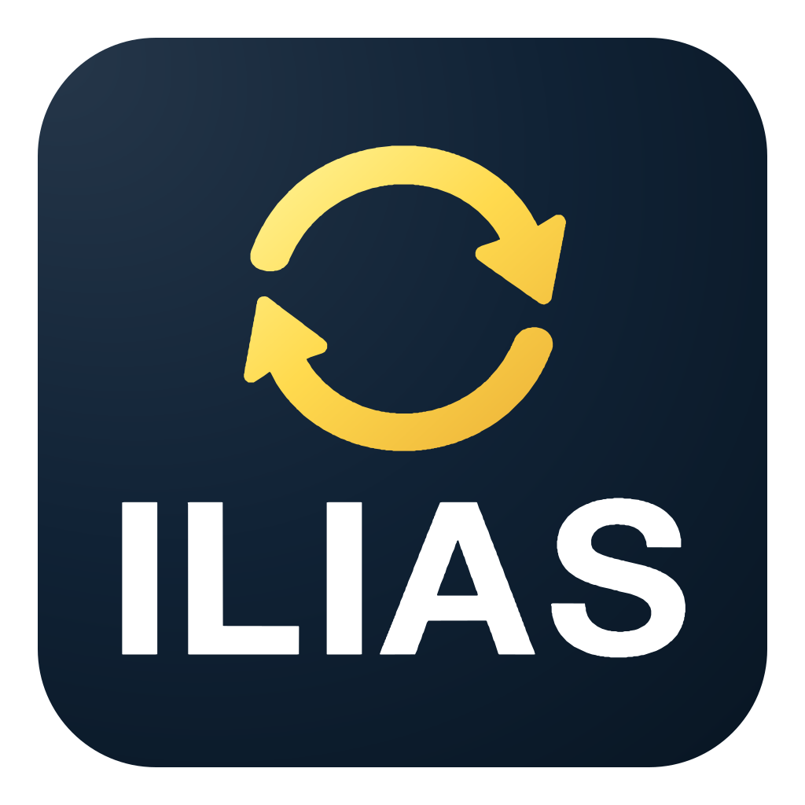
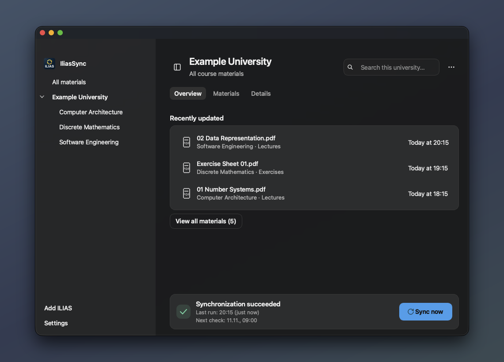
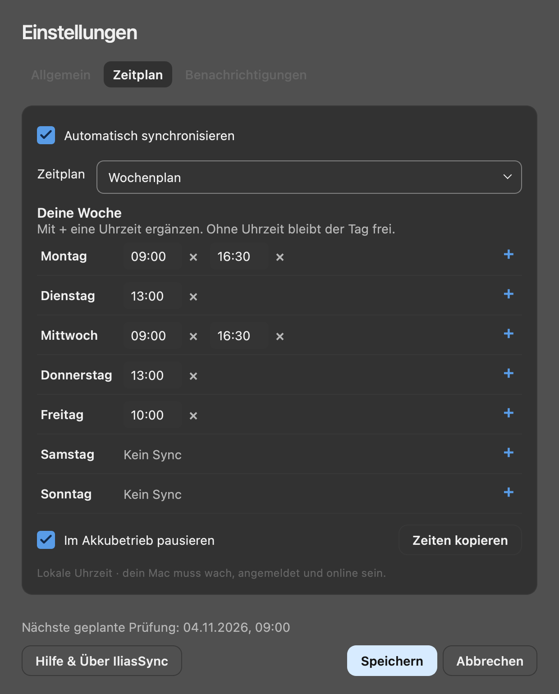
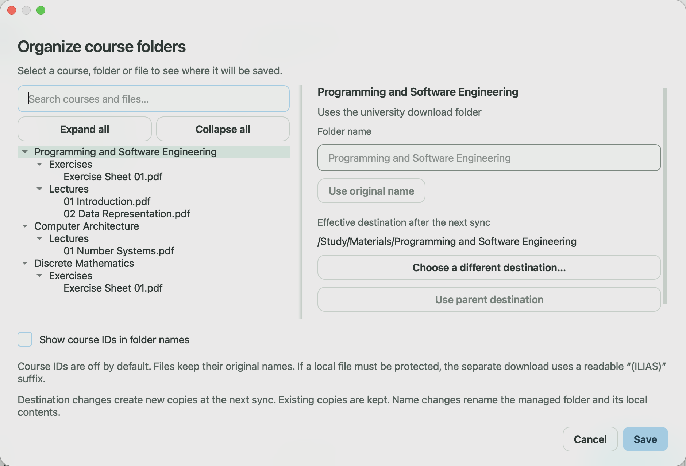

  
  <h1>IliasSync</h1>
  
<strong>Your course materials, ready on your computer.</strong>

  
Keep lecture notes and exercise sheets from ILIAS in your own folders, with automatic checks on your schedule.

  

    <a href="#download">Download</a> ·
    <a href="#get-started">Get started</a> ·
    <a href="#make-it-fit-your-workflow">Features & settings</a> ·
    <a href="https://github.com/schroedernils/ilias-sync/issues/new/choose">Help & feedback</a>
  

  

    
    
    
  

Screenshots use sample data, with no private accounts or course materials. The app is available in English and German.

IliasSync brings files from your selected ILIAS courses into one local library on **macOS, Windows and Linux**. See what was recently updated, find the document you need and open it in your usual app. Scheduled checks take care of downloading new and changed materials.

## Spend less time collecting files

- **Skip the repeated downloads.** Choose the courses you need once. IliasSync checks for new and changed files at intervals or at times you choose for each weekday.
- **Find the right material quickly.** Start with the three most recently updated files, or search and filter your library across courses and universities.
- **Study with your usual tools.** Downloaded files live in ordinary folders and open in your preferred PDF reader or other apps. Locally available files remain usable without an internet connection.
- **Keep your work when materials change.** Earlier versions are retained, detected local edits are protected, and files are not automatically deleted when they disappear from ILIAS.
- **Know when something needs you.** See the last complete synchronization and the next planned check. Sign-in, connection and file problems come with a next step and a detailed report.

No separate IliasSync account, app telemetry or additional cloud service.

## Download

**Current release: [IliasSync 1.1.2](https://github.com/schroedernils/ilias-sync/releases/latest).** Python and Qt are included; you do not need to install them separately.

| Your computer | Download | Install |
| --- | --- | --- |
| **Mac with Apple Silicon** | [DMG · arm64](https://github.com/schroedernils/ilias-sync/releases/download/v1.1.2/IliasSync-1.1.2-macOS-arm64.dmg) | Open the disk image and drag IliasSync to Applications. Native app; no Rosetta required. |
| **Mac with Intel** | [DMG · x64](https://github.com/schroedernils/ilias-sync/releases/download/v1.1.2/IliasSync-1.1.2-macOS-x64.dmg) | Open the disk image and drag IliasSync to Applications. |
| **Windows 10/11 · x64** | [Setup · EXE](https://github.com/schroedernils/ilias-sync/releases/download/v1.1.2/IliasSync-1.1.2-Windows-x64-Setup.exe) | Follow the installer, then open IliasSync from the Start menu. |
| **Ubuntu/Debian · x64** | [Package · DEB](https://github.com/schroedernils/ilias-sync/releases/download/v1.1.2/IliasSync-1.1.2-Linux-x64.deb) | Install with your package manager, then open IliasSync from the app menu. |
| **Other Linux distributions · x64** | [Archive · TAR.GZ](https://github.com/schroedernils/ilias-sync/releases/download/v1.1.2/IliasSync-1.1.2-Linux-x64.tar.gz) | Extract the archive. Run `install-desktop.sh` to add an app-menu entry; keep the extracted folder in place. |

Requires macOS 13+, Windows 10/11 x64, or Linux with glibc 2.35+ and a graphical session. Linux password storage requires Secret Service or KWallet; scheduled checks require a systemd user session. Native Windows/Linux ARM packages and mobile apps are not included in this release.

<strong>Package verification, portable Windows app and updates</strong>

Compare your download with `SHA256SUMS` in the [release](https://github.com/schroedernils/ilias-sync/releases/latest). macOS packages are ad-hoc signed but not notarized; Windows packages do not have an Authenticode signature. Your operating system may therefore require approval before opening the app.

A [portable Windows ZIP](https://github.com/schroedernils/ilias-sync/releases/download/v1.1.2/IliasSync-1.1.2-Windows-x64.zip) is also available. **Extract the entire archive before starting the app.** Keep `IliasSync.exe` and `_internal` together; running the EXE directly inside the ZIP fails.

From 1.1.0, enable automatic app-update checks under **Settings → Updates**, or check manually from the app menu on macOS or Help on Windows/Linux. macOS also offers optional automatic download and installation; Windows uses the Setup installer, and supported Linux DEB installations open the package manager after verifying the download. Update packages are signed and verified before installation.

**Coming from 1.0.4 or earlier?** Install the current version once using the download above; earlier versions do not contain the updater. Your material folders, app settings and saved schedule are kept during a normal update or reinstall. Open the app once after moving it so it can reconnect the saved schedule to its new location.

[Installation, updates and removal →](docs/INSTALLATION.md)

## Get started

1. **Connect your university.** Choose **Add ILIAS**, enter your university's ILIAS HTTPS address and check it.
2. **Sign in and choose a folder.** Use your university credentials, supported Shibboleth SSO or an imported browser session. Choose where your materials should be saved.
3. **Choose your courses and sync.** Select the courses you want to keep, then choose **Sync now**. Set up automatic checks under **Settings → Schedule**.

After setup, **Overview** shows three recently updated materials. **View all materials** opens the full list, with the newest additions and updates first. Double-click a file or press Enter to open it; use its context menu to show it in your file manager.

## Make it fit your workflow

English and German · Light, dark and system themes · Keyboard navigation and context menus

<strong>Find files across courses and universities</strong>

Browse all materials, one university or a single course from the sidebar. Search within that view, narrow results by course, file type or size, and sort by name, size or date. Browsing a course does not change which courses are synchronized.

Use the university's **⋯** menu to change sync courses, folder mappings or connection settings. Change the app language under **Settings → General → Language**.

<strong>Automatic checks that fit your timetable</strong>

Under **Settings → Schedule**, choose regular intervals, fixed daily times or a weekly plan with different times for each day. Leave a day empty to skip it. **Copy times** applies a day's times to another day, weekdays or the whole week. Changes take effect when you choose **Save**.

You can defer scheduled checks on battery power. **Sync now**, pause, resume and stop controls are available in the sync area. Stopping the current run keeps completed downloads and the schedule; turn off automatic synchronization in Settings to disable future runs.

Automatic checks need an awake computer, a signed-in user and a network connection. The operating system handles missed runs. No sync process remains running between scheduled checks.

<strong>Your folders, readable filenames and protected work</strong>

Use **University actions (⋯) → Folder mapping** to customize names and destinations for courses, subfolders or individual files. Technical course IDs are **off by default**; **Show course IDs in folder names** makes them optional. Courses with identical names receive readable numbered suffixes.

Ordinary downloads keep their filenames. If an existing file is untracked or locally edited, a separate download may use a readable suffix such as `(ILIAS)` to protect it. Earlier versions are retained under `Versions/`. Keep a separate working copy for ongoing annotations.

New destinations take effect on the next run; copies at previous destinations remain. A Google Drive, OneDrive or other cloud folder can be used as a destination. Its cloud client handles uploading and offline availability; IliasSync cannot confirm either. Keep files downloaded locally if you need to study offline.

[File preservation, naming and recovery →](docs/RECOVERY.md)

<strong>Clear recovery steps and optional problem notifications</strong>

The sync area distinguishes a complete synchronization, an in-progress check and a problem. **Details** explains affected files, unavailable content and the next action. An expired sign-in can be renewed; a missing local file can be checked and restored if it is still available on ILIAS. Existing accessible materials remain usable while you resolve a problem.

Enable system notifications under **Settings → Notifications** to hear about new sync problems. Repeated occurrences of the same problem do not generate another notification. Dismissing a notice keeps its record in Details, and notification permission is only requested after you enable the option.

[Sign-in and file recovery →](docs/RECOVERY.md)

<strong>App updates without repeating setup</strong>

Use **Settings → Updates** to decide whether IliasSync should check for new versions automatically while open. You can always check manually. Updates come from this project's GitHub releases; no GitHub account is needed. Your materials and synchronization schedule remain separate from app-update settings.

On macOS, automatic download and installation is a separate choice. Windows asks before running the Setup installer. On supported Linux DEB installations, choose **Download update**, then **Install update** to open your package manager; authorization may be required. Portable installations link to the release page. Checks and downloads authenticate signed releases, and running synchronizations defer installation.

[How app updates work →](docs/UPDATES.md)

## Privacy and compatibility

**Your library stays under your control.** IliasSync connects to your university's ILIAS installation and, where needed, its sign-in provider. It has no separate online account, app telemetry or IliasSync cloud service. Passwords are stored in your operating system's password vault. Local files remain accessible outside the app.

If you enable automatic app-update checks or start a manual check, the updater contacts GitHub to fetch release information and downloads. Update checks use no university credentials. Sparkle system profiling is disabled.

**University support varies.** ILIAS versions, themes, plugins and sign-in flows differ; not every university or SSO configuration has been verified. MFA may require importing your own Netscape-format `cookies.txt` export and renewing it when it expires. IliasSync does not read your browser profile. Treat session exports like passwords. [Sign-in options →](docs/INSTALLATION.md#anmeldung)

**Course files are not a full offline copy of ILIAS.** Forums, tests, surveys, SCORM and some external content are outside the supported library. Unavailable or unsupported items are listed in reports. Check duration depends on the university, connection and amount of new material; repeated checks reuse local indexes and respect server-requested waiting periods. [How synchronization works →](docs/SYNC_PERFORMANCE.md)

IliasSync is independent of ILIAS and your university. Use only accounts and materials you are authorized to access, and follow your institution's rules and the rights attached to course content.

## Help and contribute

[Report a bug](https://github.com/schroedernils/ilias-sync/issues/new/choose) or [suggest an improvement](https://github.com/schroedernils/ilias-sync/issues/new/choose). Include your operating system, app version or build ID, and steps to reproduce the issue. Do not share passwords, cookies, private course materials or unredacted account details. Report security vulnerabilities privately as described in [SECURITY.md](SECURITY.md).

| Guide | What you will find |
| --- | --- |
| [Installation](docs/INSTALLATION.md) | Requirements, sign-in, package verification, updates and removal |
| [Recovery](docs/RECOVERY.md) | Login problems, missing files, local changes and older versions |
| [Development](docs/DEVELOPMENT.md) | Run from source, test and build native packages |
| [Contributing](CONTRIBUTING.md) | Prepare a focused bug report or pull request |
| [Architecture](docs/ARCHITECTURE.md) | How the application and synchronization components fit together |
| [Verification](docs/VERIFICATION.md) | Completed checks and the limits of their evidence |

Some linked guides are currently in German.

## Open source

IliasSync is licensed under [GPL-3.0-or-later](LICENSE), with no ads. Downloading is powered by [PFERD](https://github.com/Garmelon/PFERD) (MIT). Qt and other dependencies retain their respective licenses; license texts and notices are included in the packages. See [third-party notices](THIRD_PARTY_NOTICES.md).
